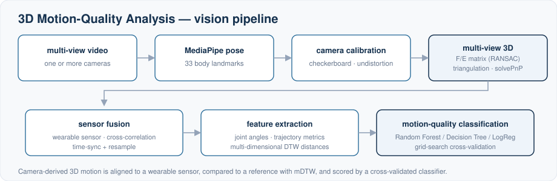
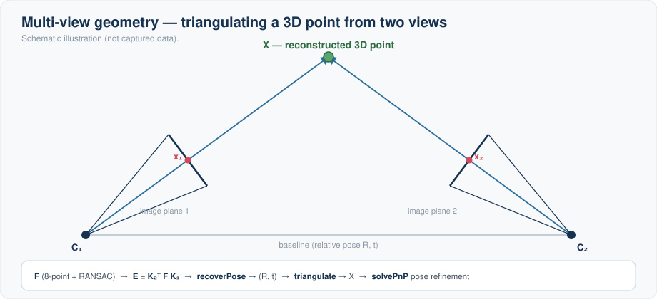
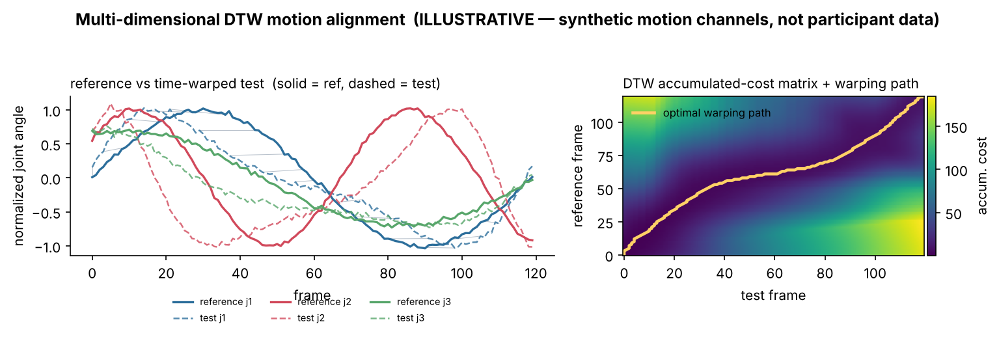

# 3D Motion-Quality Analysis

A computer-vision pipeline that **quantifies the quality of human 3D motion from
cameras** and compares it against a reference, using pose estimation, multi-view
geometry, sensor fusion and dynamic time warping.

> Independent M.Sc. project. **No data, videos or subject information are included
> in this repository** — only the source code.

## Pipeline

MediaPipe lifts 2D body landmarks, multi-view geometry reconstructs them in 3D,
the camera-derived motion is time-aligned to a wearable sensor, and
multi-dimensional DTW distances feed a cross-validated motion-quality classifier.

## What it does

1. **Pose estimation** — extracts 3D body landmarks with **MediaPipe**.
2. **Camera calibration & undistortion** — OpenCV checkerboard calibration,
   distortion removal.
3. **Multi-view 3D reconstruction** — fundamental/essential matrix (RANSAC),
   `recoverPose`, triangulation and `solvePnP` to lift 2D keypoints into 3D.
4. **Sensor fusion** — aligns the camera-derived motion with a wearable motion
   sensor by **cross-correlation** time-synchronization and resampling.
5. **Feature extraction** — joint angles, trajectory metrics and
   **multi-dimensional DTW** distances between sequences.
6. **Classification** — Random Forest / Decision Tree / Logistic Regression with
   grid-search cross-validation and confusion-matrix evaluation.

## Multi-view geometry

*Schematic.* A 3D point is recovered from two calibrated views: estimate the
fundamental matrix **F** (8-point + RANSAC), form the essential matrix
**E = K₂ᵀ F K₁**, `recoverPose` to get the relative rotation/translation **(R, t)**,
then triangulate the back-projected rays to **X**; `solvePnP` refines camera pose
from 2D–3D correspondences.

## Motion comparison (mDTW)

*Illustrative only — synthetic multi-channel motion signals, not participant data.*
A reference motion and a time-warped test motion are aligned with
multi-dimensional Dynamic Time Warping; the right panel shows the accumulated-cost
matrix and the optimal warping path. The DTW distance is one of the features used
to score motion quality.

## Modules (overview)

| File | Role |
|---|---|
| `estimation_mediapipe_pose.py`, `plot_function_mediapipe_pose.py` | pose estimation + visualization |
| `calibration.py` | camera calibration / undistortion |
| `projection.py`, `transformation.py` | multi-view geometry, 2D↔3D projection |
| `functions_general.py`, `Class_MP.py` | shared helpers / data structures |
| `DTW_analysis.py`, `DTW_analysis_3d.py` | (multi-dimensional) dynamic time warping |
| `main_mediapipe_loc_lab_angle_estimation.py`, `main_02.py` | pipeline entry points |
| `Abschlussarbeit/` (`M.py`, `rf.py`, `main.py`) | feature aggregation + classification |

## Tech stack

Python · OpenCV · MediaPipe · NumPy · SciPy · pandas · scikit-learn · Matplotlib

## Data & privacy

This repository contains **no recordings, sensor data, or any participant
information**. The scripts expect you to point them at your own local data
directory. Paths are configurable at the top of the entry-point scripts.

## License

See [`LICENSE`](./LICENSE) — shared for evaluation purposes only.
